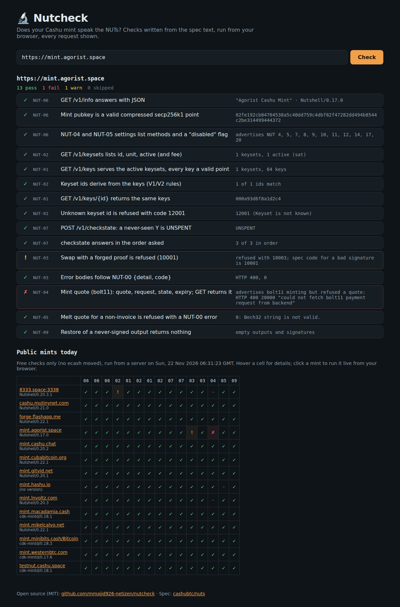
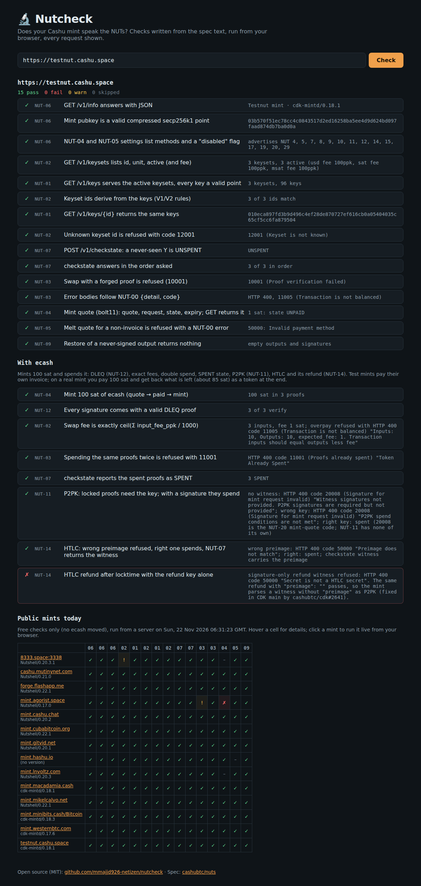

# 🔬 Nutcheck — does your Cashu mint speak the NUTs?

**Live: https://mmajjd926-netizen.github.io/nutcheck/**

Paste a mint URL, get a conformance report. Each check is written from the text of the
[NUT specs](https://github.com/cashubtc/nuts), talks to the mint over plain HTTP from your browser and
shows the exact request and response, so a mint operator (or a wallet developer chasing a bug) can see
*why* something fails, not just that it does.



## What it checks (no ecash needed)

| NUT | Check |
|---|---|
| 06 | `/v1/info` answers; `pubkey` is a valid compressed secp256k1 point; NUT-04/05 settings have `methods` and `disabled` |
| 02 | `/v1/keysets` entries have `id`, `unit`, `active`, a non-negative integer `input_fee_ppk`; legacy base64 ids flagged |
| 01 | `/v1/keys` serves only active keysets, every key a valid point, amounts positive integers; `/v1/keys/{id}` agrees |
| 02 | **Keyset ids re-derived from the keys** (V2: `amount:pubkey,…|unit:…|input_fee_ppk:…|final_expiry:…`, V1: first 7 bytes of the hash), implemented independently of any wallet library |
| 02 | Unknown keyset id → error `12001` |
| 07 | `checkstate` of a never-seen `Y` is `UNSPENT`, answers in the order asked |
| 03 | A swap with a forged proof is refused with `10001`, never signed; error bodies are `{detail, code}` |
| 04 | A bolt11 mint quote has `quote`, a bolt11 `request`, `state`, `expiry`; GET by id returns it (unit and minimum taken from the mint's own settings) |
| 05 | A melt quote for a non-invoice is refused with a NUT-00 error |
| 09 | Restoring a never-signed blinded message returns empty `outputs`/`signatures` |
| 17 | WebSocket `/v1/ws`: `nuts.17.supported` is a list of `{method, unit, commands}`; subscribing to a fresh mint quote and to a never-seen `Y` is acknowledged `{status: "OK", subId}` and **immediately followed by the current state** (UNPAID / UNSPENT), as the spec's MUST requires; `unsubscribe` answers OK; an unknown `kind` gets a JSON-RPC error. Every frame in and out is shown |

The random points used as fake `Y`, `C` and `B_` are fresh public keys, so nobody knows their discrete log.

## With ecash ("Run with ecash")

Mints 100 sat and spends it. Test mints (testnut) pay their own invoice, so this runs by itself; on a real
mint you pay a 100-sat invoice and get what is left back as a token.

| NUT | Check |
|---|---|
| 04 | quote → paid → mint 100 sat |
| 12 | every blind signature carries a DLEQ proof that verifies |
| 02/03 | the swap fee is exactly `ceil(Σ input_fee_ppk / 1000)`: one sat too much out is refused (`11005`), one too little is refused, the exact swap is signed |
| 03 | the same inputs again → `11001` |
| 07 | those inputs now read `SPENT` |
| 09 | **restore**: after a swap into 3 outputs (4 + 2 + 1 sat), `/v1/restore` with those outputs and a never-signed one in the middle returns exactly the 3 signed outputs, in order, with the same `C_` the swap gave (what a wallet recovering from its seed depends on) |
| 05/08 | melt: a melt quote for a 5 sat invoice from the mint itself, paid with inputs above amount + fee reserve and `ceil(log2(overpaid))` blank outputs; the payment reads `PAID` and the change is all of the overpaid sats except what the payment cost (never more, never less than overpaid − reserve), in powers of two |
| 19 | if the mint lists `/v1/swap` as cached: the very same swap request sent again within the TTL gets the same signatures back, not `11001` (a wallet that lost the response can recover its outputs) |
| 20 | a mint quote with a `pubkey`: minting without a signature is refused, a Schnorr signature from the wrong key is refused, the right signature over `sha256(quote ‖ B_0 ‖ … ‖ B_n)` mints. Accepting either of the first two would let anyone who sees the quote id take the ecash |
| 11 | P2PK: no witness refused, a valid Schnorr signature from the *wrong* key refused, the right key spends |
| 11 | **P2PK 2-of-2** (`pubkeys` + `n_sigs: 2`): one signature refused, the *same* key's signature twice refused (BIP-340 signing is deterministic, so a mint that counts signatures instead of signers would take it), both keys in either order spend |
| 11 | **P2PK `SIG_ALL`**: signatures over each secret only (as for `SIG_INPUTS`) refused; a valid `SIG_ALL` signature for outputs A sent with outputs B refused (what `SIG_ALL` exists to stop); the right one over `secret‖C` of every input then `amount‖B_` of every output spends. If it is refused, the legacy transcript (`secrets‖B_`) is tried and reported |
| 14 | HTLC: a wrong preimage refused, the right one spends, `checkstate` returns the witness with the preimage |
| 14 | **HTLC refund**: before the locktime the refund key is refused; after it, a signature-only witness (what wallets send) must spend |

On testnut (CDK 0.18.1) everything passes except the last one:

> signature-only refund witness refused: HTTP 400 code 50000 "Secret is not a HTLC secret". The same refund with
> `"preimage": ""` passes, so the mint parses a witness without `"preimage"` as P2PK (fixed in CDK main by cashubtc/cdk#2641).

Melt, restore, NUT-19, NUT-20, 2-of-2 and `SIG_ALL` pass on testnut too. On a local Nutshell 0.20.2 (FakeWallet backend) all pass (NUT-19 is skipped: its cache is off by default), including the signature-only refund,
except `SIG_ALL`, which is a **warn**: 0.20.2 only accepts the legacy message (`secrets‖B_`), so a wallet on the current
spec (cashu-ts 4, CDK ≥ 0.14) cannot spend `SIG_ALL` ecash at such a mint, and a wallet on the old one cannot spend at CDK
mints. Nutshell 0.21.0 signs the current transcript (`sigall_message_to_sign` in `cashu/core/nuts/nut11.py`), so this is an upgrade-path note rather than a bug: mints on 0.20.2 or older need the upgrade before their users can use `SIG_ALL` (0.20.3 already has the new one; I checked both wheels).
By the version in `/v1/info` (read on 22 Nov, not spent against), three of the public mints in the table are on such versions:
mint.cashu.chat (0.20.2), mint.gitvid.net (0.20.1) and mint.agorist.space (0.17.0).
Both mints count signers, not signatures, in the 2-of-2 check;
Nutshell reports the unbalanced swap as `11000` and a missing witness as `0` (neither in the error table).
Reported upstream as [cashubtc/cdk#2980](https://github.com/cashubtc/cdk/issues/2980) (backport request).

That is a real interop break today: cashu-ts signs HTLC refunds without a `preimage`, so refunds fail on
CDK 0.18.x mints (I hit it building [Nutcache](https://github.com/mmajjd926-netizen/nutcache)). Also visible: CDK
answers P2PK failures with `20008`, which the error table reserves for NUT-20 mint-quote signatures.



## Public mints today

`tools/matrix.mjs` runs the same checks from a server against public mints and writes `public/matrix.json`,
shown under the form. First run (22 Nov 2026, 14 reachable mints, Nutshell 0.17–0.22, CDK 0.17–0.18):

- Every reachable mint derives its keyset ids correctly and refuses forged proofs.
- `mint.agorist.space` (Nutshell 0.17.0) advertises bolt11 minting but cannot create an invoice
  (`20000 could not fetch bolt11 payment request from backend`), and still answers forged proofs with the
  old code `10003` instead of `10001`.
- `8333.space:3338` still lists two inactive keysets with pre-V1 base64 ids.
- Nutshell answers generic errors with `code: 0`, CDK with `50000`; neither is in the error table.
- NUT-17 (added later the same day): every CDK mint checked (testnut, Minibits, Macadamia, WesternBTC; cdk-mintd 0.17–0.18)
  acknowledges a `proof_state` subscription for a `Y` it has never seen but sends **no** current-state notification,
  where Nutshell sends `UNSPENT` at once; NUT-17 says the mint MUST first send the current state, and NUT-07 says an
  unseen proof is `UNSPENT`. Mint-quote subscriptions work on both. Cause and one-line fix: [cashubtc/cdk#2981](https://github.com/cashubtc/cdk/issues/2981)
  (the subscription backfill drops proofs with no DB row; `/v1/checkstate` maps them to `UNSPENT`); fix with a regression test: [cashubtc/cdk#2982](https://github.com/cashubtc/cdk/pull/2982). `cashu.mutinynet.com` and `mint.mikelcalvo.net`
  advertise NUT-17 but `/v1/ws` answers HTTP 404 (checked with a plain upgrade request too), so wallets that prefer
  websockets there get nothing.

## Run it

```
npm install
npm run dev                                   # the web page
NUTCHECK_LIVE=1 npx vitest run                # free checks on testnut and Minibits + all ecash checks on testnut, printed
node --experimental-strip-types tools/matrix.mjs   # refresh public/matrix.json
```

Made for [Nut November](https://nutnovember.org/) 2026. MIT.
